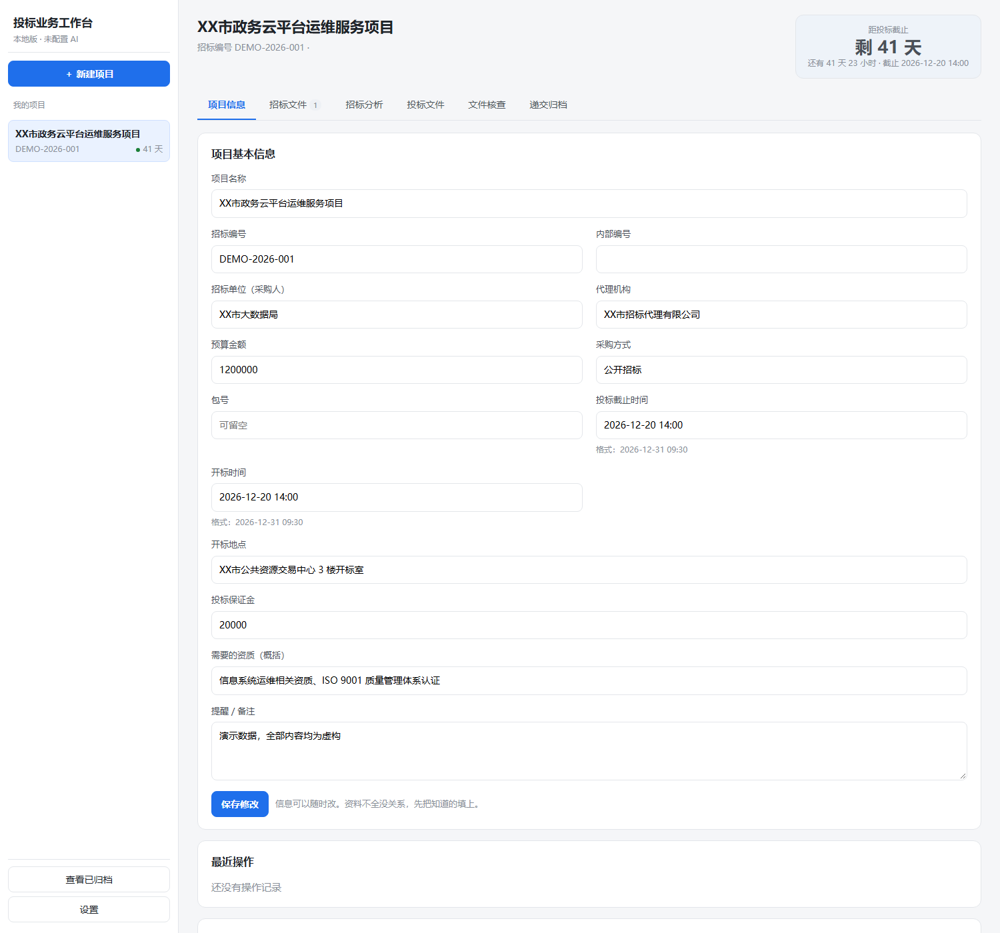
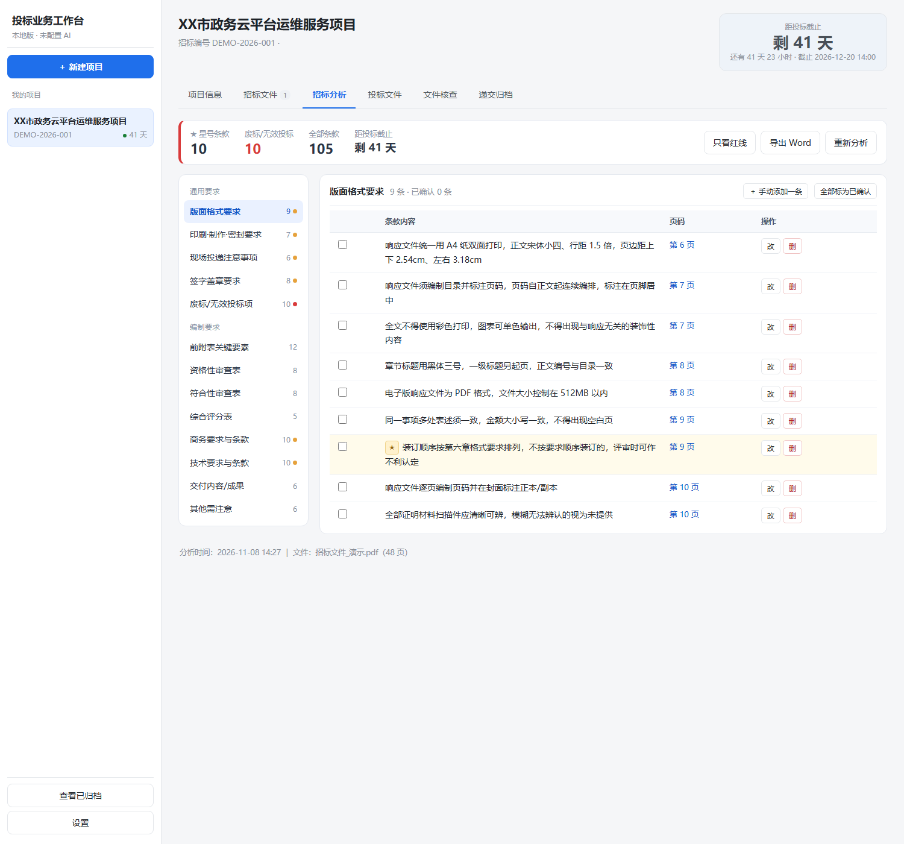
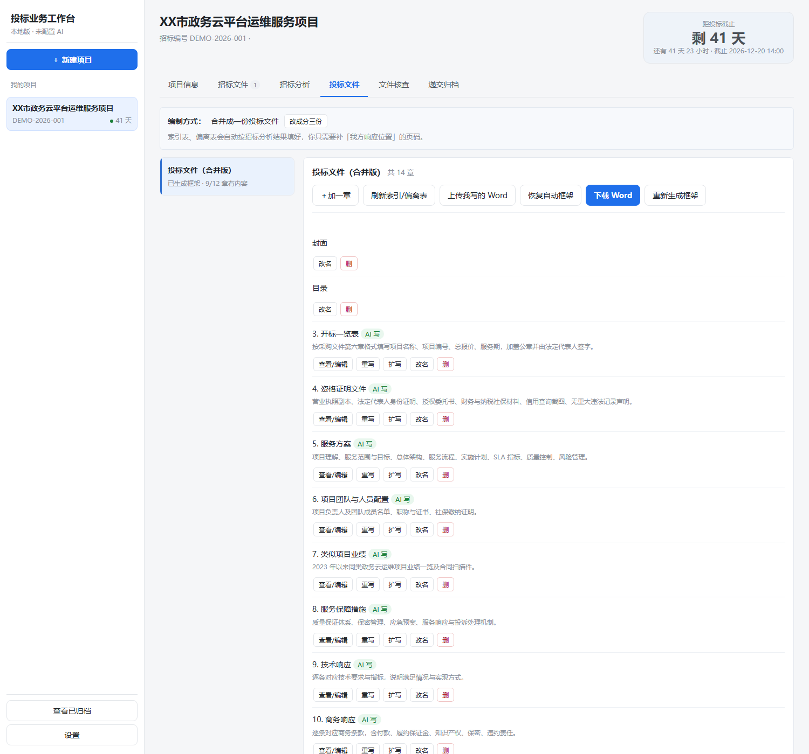
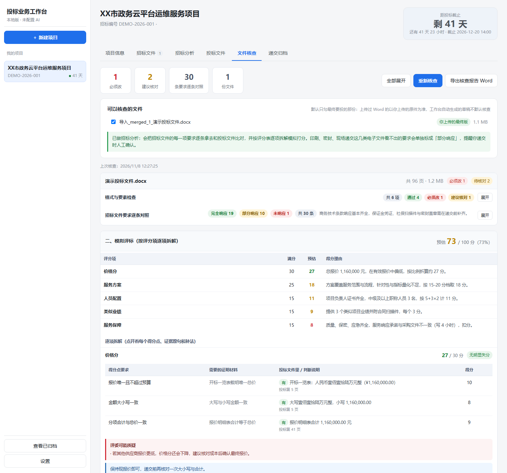
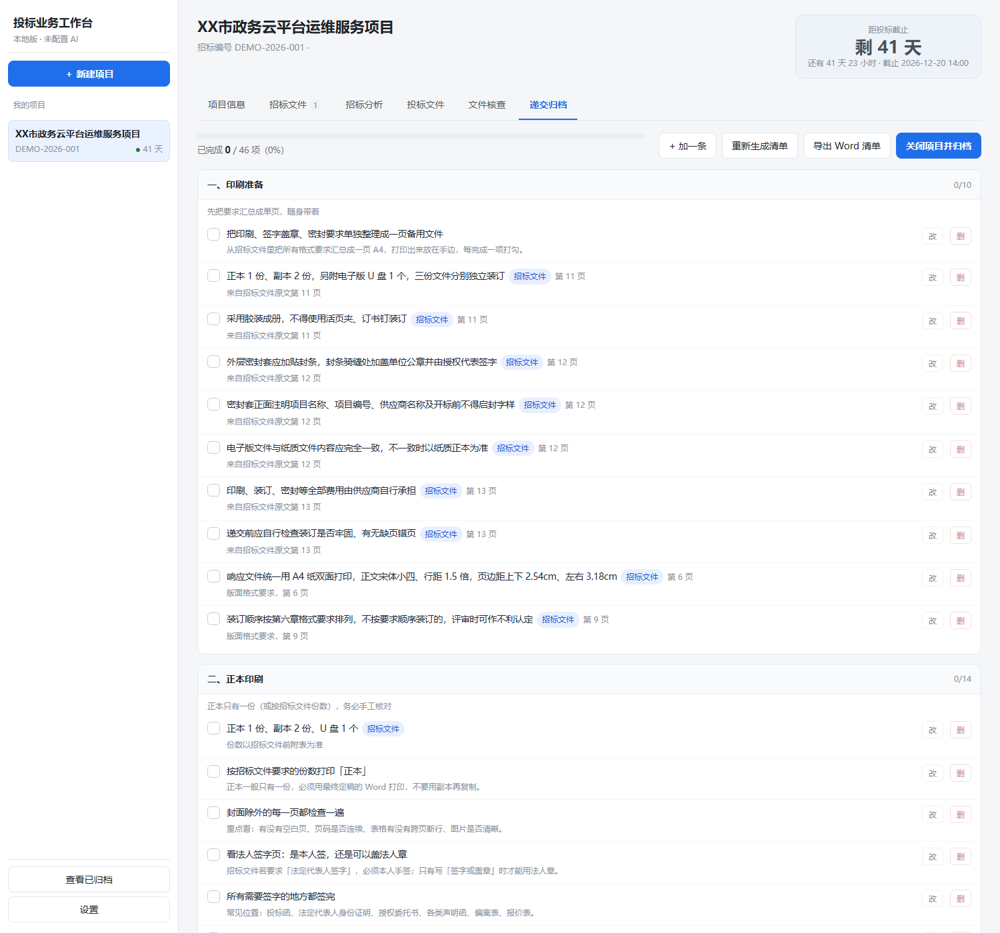
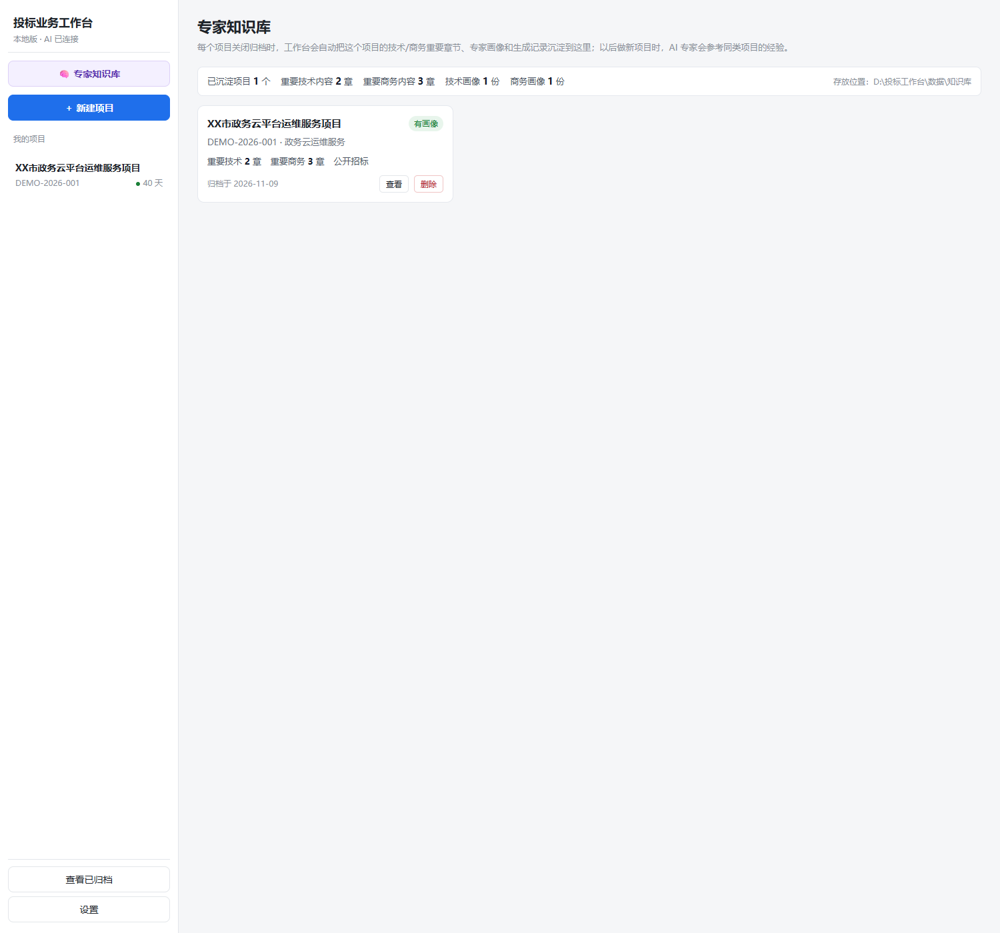
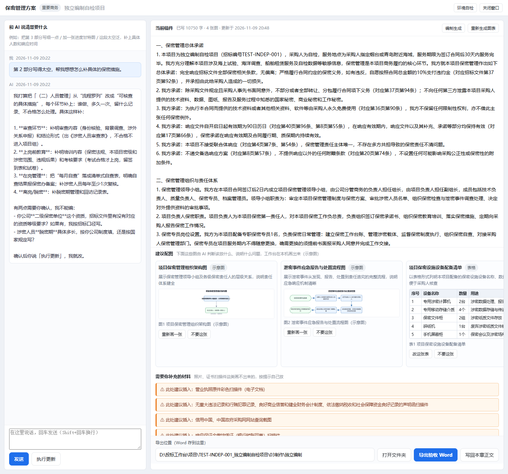
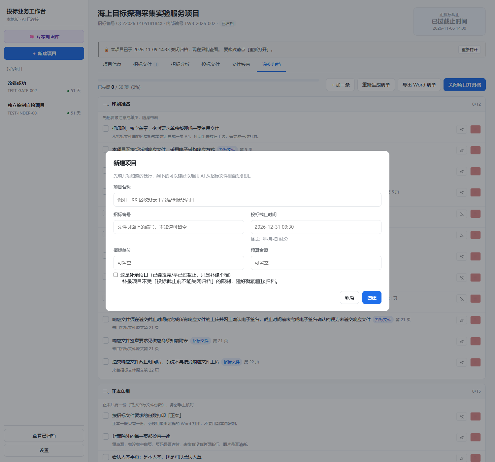
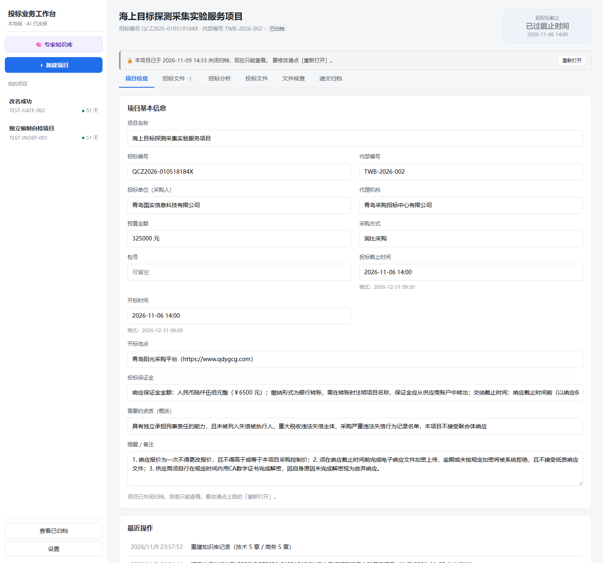

# 投标业务工作台（bid-bench）

> 面向投标专员的全流程本地工作台：把「读懂招标文件 → 写标书 → 自检 → 递交 → 归档」这条链路搬到一张网页上，重点环节用 AI 辅助，其余靠点击推进。
>
> 当前版本 **1.1.2**（2026-11-10）· 开源协议 MIT

---

## 一、这是什么

投标这件事的难点通常不在「写字」，而在四件事上：

1. **招标文件厚、要求散**：前附表、资格性审查表、符合性审查表、评分表、商务条款、技术条款、废标条款分散在几十上百页里，靠人眼过一遍必然漏。
2. **漏一条就可能废标**：星号条款、废标项、签字盖章要求、份数装订要求，漏一个直接出局。
3. **写完没人逐条对照**：自己写的标书到底响应了哪几条、哪几条只是写了一句「完全响应」，很难自证。
4. **递交当天手忙脚乱**：正副本份数、骑缝章、密封封面、U 盘光盘、授权代表随身带什么，全凭记忆。

这个工作台就是围绕这四件事做的：**把招标文件拆成一条条可勾选的要求，拿你的标书一条条去对，再按评分表模拟打分，最后给出可打印的递交清单。**

适合：中小企业投标专员、做标书的外包/代写、需要经常投政府采购或工程服务类项目的团队。

---

## 二、能做什么（六个模块）

工作台按真实业务流程组织，一个项目从头走到尾就是六个页签：

| 模块 | 你做什么 | 工作台做什么 |
|---|---|---|
| **1. 项目信息** | 上传招标文件（.pdf / .doc / .docx），或手填项目名称、编号、预算、截止时间、开标地点 | 自动识别文件页数与文字，建立项目文件夹，首页始终显示「距投标截止还有几天」并标红 |
| **2. 招标文件** | 看一眼识别结果 | 保存原件、抽文字、统计页数；解析失败会明确报错而不是静默跳过 |
| **3. 招标分析** | 点「开始分析」 | 输出 13 个板块的关键信息清单：版面格式要求、印刷制作与密封要求、授权代表现场递交注意事项、法人及授权代表签字盖章要求、废标/无效投标项、前附表、资格性审查表、符合性审查表、综合评分表、商务要求、技术要求、交付内容、其他；每条带页码、★星号、废标标记，可增删改，可导出 Word |
| **4. 投标文件** | 选「分三份」或「合并成一份」；可以让 AI 生成正文，也可以直接上传自己写好的 Word | 按招标文件格式生成价格文件/商务技术文件/资格证明文件（或合并版）的 Word 框架：封面、目录、章节、页码；索引表（商务/技术/资格）与偏离表自动带出；上传自己的 Word 时**按你原文档的标题层级与编号整份替换章节**，可一键恢复自动框架；**v1.1.0：自动识别「重要技术 / 重要商务」章节（可点标签人工切换），写这类章节前先给一份可修改的「专家画像」请你确认，再以技术专家 / 商务专家身份撰写**；**v1.1.2：重要章节可开「独立编制」窗口——左边和 AI 多轮对话，右边实时改稿，AI 判断该配什么图/表并由本机渲染，导出验收用 Word（带「此处建议插入图」的醒目提示），也能一键写回正文** |
| **5. 文件核查** | 勾选要查的文件，点「开始核查」 | 两层检查：① 格式与硬性要素（空白页、页码连续性、封面要素、未填占位符、日期与项目名称一致性）；② **招标文件要求逐条对照**——把分析出的全部要求逐条和标书比对，给出「完全响应 / 部分响应 / 未响应 + 证据原句 + 第几页 + 怎么补」；再按评分表**逐评分项拆解模拟评标**（得分点、需要的证明材料、证据、扣分理由、怎么补、能加几分），并单独统计「废标/★条款未完全响应」数量——这类条款没有「部分响应」一说，缺材料就是废标风险，必须补齐；最后按可加分排序给提分清单。可导出完整核查报告 Word |
| **6. 递交归档** | 逐条勾选 | 生成 50 条五组行动清单：印刷准备 / 正本印刷 / 副本印刷 / 胶装密封 / 电子版；可改可删可导出打印；**v1.1.2：投标截止前不允许关闭归档（真不投可走「放弃投标」），到点关闭需手动输入「关闭归档」四字确认**；归档到「归档/年份/编号_项目名」，过程记录一并写入 `06过程记录/`，归档后项目转为只读 |

---

## 三、几个关键设计（为什么这么做）

- **先本地、后 AI**：所有文件、数据库、导出结果都在你自己的电脑上。只有「招标分析」「AI 写正文」「逐条对照」「模拟评标」这几步，会把招标文件/标书的**文本片段**发给你自己填的 DeepSeek API Key 所对应的接口。没有账号体系、没有云端存储、没有遥测。
- **AI 不做「满分作文」**：写正文时系统提示词强制「只能以本题招标文件原文为依据」，技术类章节必须一条一条对应技术需求/指标，禁止写「放在任何项目上都成立」的通用模板；核查时只认标书里的**证据原句**，找不到就写「全文未检索到」，不编造。
- **核查默认只查「你上传的最终版」**：自己上传的 Word 才是最终要投的那份，工作台自动生成的草稿默认不参与核查，避免把草稿的问题算到标书头上。
- **评标像真人评委一样找证据**：标书里有评分索引表的，先按索引定位再回原文复核（索引页码不准会记成风险点）；没有索引表的，按评分项关键词在全文检索最相关页面；文件很长时会明确提示「有 N 页没放进本次范围，请人工确认」，不假装全看过。
- **装订密封这类「电子文件看不出来」的要求**，统一标成「部分响应」并提醒现场人工确认，不冒充通过。
- **重要章节不是「通用模板」**：技术方案、试验方案这类章节和商务的组织机构、质量、保密、进度、售后这类章节，决定能不能拿分。工作台会先把它们标出来（蓝/紫标签，判错点一下就改），写之前先把「AI 怎么理解这个项目」用一段大白话摆给你看，你确认或改完再动笔；写的时候切换成技术专家 / 商务专家身份，先把项目的技术逻辑、管理逻辑理顺再落笔。原来那套「严格依据招标文件原文、技术条款逐条对应」的硬性策略一条不减，是叠加在专家身份之上的。
- **经验会沉淀，但不会越权**：项目点「关闭并归档」时，重要技术/商务章节正文、专家画像和生成记录会沉淀进本地知识库。以后做同类项目，AI 会拿最近 3 个相似项目做参考——但提示词里写死了「只能借鉴思路与环节覆盖，绝不能照搬项目名称、招标人、金额、指标数值、业绩」，一切以本次招标文件原文为准。知识库为空时就是纯 AI 策略，不影响使用。

---

## 四、效果预览

> 下面截图来自一个**完全虚构的演示项目**（XX市政务云平台运维服务项目 · 编号 DEMO-2026-001）。公司名、金额、人名、页码全部是假数据，只用于展示界面，与任何真实项目无关。

**① 项目信息**：首页始终显示「距投标截止还有 41 天」，临期自动标红。



**② 招标分析**：48 页招标文件 → 13 个板块 105 条要求，★星号 10 条、废标/无效投标 10 条；每条带页码，可逐条增删改，可导出 Word。



**③ 投标文件**：可选「合并成一份」或「分三份」；章节能 AI 写正文、手写，也能上传自己写好的 Word 按原编号整份替换（可一键恢复自动框架）。v1.1.0 起自动标注「重要技术（蓝）/ 重要商务（紫）」，写这类章节前先确认一份可修改的「专家画像」，再以技术/商务专家身份撰写。



**④ 文件核查**：格式与要素检查 + 招标要求逐条对照（完全响应 19 / 部分响应 10 / 未响应 1）+ 按评分表逐项拆解模拟评标 73/100 与提分清单（每条带证据原句、页码、怎么补、能加几分）。



**⑤ 递交归档**：五组 46 条行动清单（印刷准备 / 正本印刷 / 副本印刷 / 胶装密封 / 电子版），逐条勾选，可导出打印。



**⑥ 专家知识库**：每个项目关闭归档时，重要技术/商务章节正文、专家画像和生成记录自动沉淀到这里；以后做同类项目，AI 专家会参考它们的思路（不照搬内容）。



**⑦ 独立编制（v1.1.2）**：左边和 AI 多轮对话，右边实时看稿；AI 判断这段该配什么图/表，本机渲染成图，导出验收用 Word。



**⑧ 关闭归档门禁（v1.1.2）**：投标截止前不能归档，明确告诉你还剩几天；真不投可走「放弃投标，关闭归档」。



**⑨ 归档后只读（v1.1.2）**：归档项目顶部灰横幅提示，编辑按钮全部隐藏，要改先「重新打开」。



真实项目的典型量级：50～60 页招标文件解析约 2 分钟得到 300+ 条要求；160 页标书逐条核查约 45 秒；核查报告 Word 二三十页。

---

## 五、环境要求

| 项目 | 要求 |
|---|---|
| 操作系统 | **Windows 10 / 11**（导出 PDF、Word 转 PDF 走 Microsoft Word 的 COM 接口） |
| Node.js | **22.5 或更高**（推荐 22 LTS 以上；内置 node:sqlite 从 22.5 开始提供） |
| Microsoft Word | **建议安装**（.docx → PDF 转换、目录页码刷新要用；没有 Word 时核查只能看 .docx 文字，无法按页统计） |
| DeepSeek API Key | 需要（在 platform.deepseek.com 申请）。不填也能用：项目信息、招标文件、框架生成、格式检查、递交清单都可用，只是 AI 分析/写正文/评标不可用 |

> 不需要数据库服务、不需要 Python、不需要 Docker、不需要联网运行（除调用 AI 时）。

---

## 六、快速开始

### 1）装依赖

双击 `scripts\install.bat`（或在仓库根目录执行 npm install）。第一次会下载约 100MB 依赖，请耐心等。

### 2）启动

双击 `scripts\start.bat`，会自动打开浏览器到 http://127.0.0.1:7830 。关闭服务双击 `scripts\stop.bat`。

### 3）填 API Key

打开页面左下角 **「设置」** → 粘贴 DeepSeek API Key → 保存。Key 只存在本机 `app/config.json`（该文件已被 .gitignore 排除，**不要提交**）。

### 4）跑第一个项目

新建项目 → 拖入招标文件 → 「招标分析」点开始分析 → 「投标文件」选编制方式并生成框架（或上传自己写好的 Word）→ 「文件核查」开始核查 → 「递交归档」逐条勾选 → 完成后「关闭项目」归档。

更细的操作说明见 **[使用说明.md](使用说明.md)**。

---

## 七、目录结构

```
bid-bench/
├─ app/                    程序本体
│  ├─ server.mjs            零框架 HTTP 服务 + 路由 + 后台任务
│  ├─ web/                  原生前端（无构建步骤）
│  │  ├─ index.html
│  │  ├─ app.js             单文件前端应用（视图 + 交互）
│  │  └─ style.css
│  ├─ lib/                  业务模块（取文字/分析/写标书/专家画像/知识库/核查/评标/导出/归档）
│  └─ config.example.json   配置模板（复制成 config.json 再填 Key）
├─ scripts/                 install / start / stop
├─ docs/                    架构说明
├─ 使用说明.md               面向使用者的详细说明
├─ LICENSE                  MIT
└─ README.md
```

运行后会在仓库根目录生成（均已被 .gitignore 排除）：

```
数据/      数据库、上传文件、分析结果、制作稿、核查结果、预览图
项目/      每个项目的 01招标文件 / 02分析 / 03制作 / 04核查 / 05递交
归档/      关闭后的项目
模板/      预留
```

> 想把程序和数据分开放（例如数据放 D 盘）：设置环境变量 TWB_ROOT=D:\\我的投标工作台 再启动，程序文件不用动。

---

## 八、技术栈（想看代码的看这里）

- **后端**：Node.js 原生 http，无 Express/Koa；路由表 + JSON 接口；后台任务用内存任务表 + 轮询（长任务不阻塞请求）；数据库用内置 node:sqlite 的 DatabaseSync，零额外依赖。
- **前端**：原生 ES 模块 + 手写 CSS，没有 React/Vue、没有打包器，改完刷新即可。app/web/app.js 是单文件应用（视图函数 + 事件委托）。
- **文档处理**：docx（生成 Word，含固定列宽表格）、mammoth（读 Word 文本）、pdfjs-dist（PDF 取文字/页数/逐页图片计数）、pdf-to-img（预览渲染）；.docx 转 .pdf 走 Microsoft Word COM（PowerShell）。
- **AI**：DeepSeek deepseek-flash（支持图片输入、长上下文）。调用带重试、并发上限、JSON 解析兜底；长文档用**页级 bigram 检索**挑最相关页再送模型，控制 token 同时保证召回。
- **自研小工具**：docxZip.mjs（零依赖解 zip）、docxOutline.mjs（按 styles.xml 与 numbering.xml 还原标题层级和自动编号）、export*.mjs（dxa 固定列宽表格排版）。
- **专家画像与知识库**：profile.mjs（画像生成/确认/修改记录）、knowledge.mjs（按采购方式+技术关键词重合度检索同类项目，只用本地 JSON，不引入向量库）。

更多见 [docs/架构说明.md](docs/架构说明.md)。

---

## 九、隐私与数据

- 项目文件、上传的招标文件与标书、数据库、导出的 Word/PDF，**全部只在本机**。
- 只有以下动作会把文本片段发到 DeepSeek 接口：招标分析、AI 写正文、逐条对照、模拟评标。不需要 AI 时完全不联网。
- 专家知识库同样是本地 JSON 文件（`数据/知识库/`），不上传任何地方；删除某个项目的知识库记录不会影响归档文件夹。
- 仓库里**不包含**任何真实项目数据、上传文件、API Key。.gitignore 已排除 数据/ 项目/ 归档/ app/config.json。
- 建议：不要把带真实投标人信息的标书提交到公开仓库或 issue。

---

## 十、已知限制

1. **扫描件靠 AI 视觉识别，不是本地 OCR**：整页扫描的 PDF/Word 抽不出文字时，会把页面转成图片交给 DeepSeek 视觉逐页识别（需要 API Key，页数多时较慢、按页计费）；没配 Key 时只能统计页数，并明确提示「另有 N 页是整页扫描图，请人工翻一遍」，不会瞎猜。
2. **依赖 Microsoft Word**：没装 Word 时 .docx 无法转 PDF，页数、页码、空白页检查会退化；纯 .docx 文字内容仍可读。
3. **AI 输出必须人工复核**：模型可能误判「已响应」，报告里的每条结论都带证据原句与页码，请对照原文确认后再投。
4. **超长标书只核对最相关页**：161 页这类标书，逐条对照与评标会按页检索挑相关页送模型，界面会显示「有 N 页未纳入，请人工确认」。
5. **只针对中文招投标语境**：提示词、板块划分、术语都按国内政府采购/工程服务类项目设计。

---

## 十一、参与贡献

欢迎 issue / PR：

- 反馈某类招标文件（如工程类、货物类、竞争性磋商）解析不准的案例（请先脱敏）。
- 补充评分办法的解析规则。
- 前端交互与排版改进。
- 只要不引入真实项目数据、不提交 API Key，都欢迎。

---

## 十二、免责声明

本工具输出的分析、标书框架、核查结论、模拟评分均为**辅助参考**，不构成投标合规承诺。投标文件是否符合招标文件要求，最终以招标文件原文和评标委员会认定为准。使用本工具造成的任何后果由使用者自行承担。

---

## 十三、开源协议

[MIT](LICENSE) © 2026 bid-bench contributors

---

## 十四、更新记录

**v1.1.2**
- **重要技术 / 重要商务章节新增「独立编制」**：章节行和正文面板上多一个按钮，点开是一个**独立的浏览器窗口**（左边和 AI 对话，右边实时看稿子）。可以多轮说「第 2 部分太空泛」「加一张进度表」，说完点「执行更新」由 AI 按对话重写整稿；关掉窗口再打开，对话和稿子原样还在。
- **独立编制能出图、出表**：AI 先判断这段内容该不该配图、配什么图（流程图、架构图、甘特图、时间轴、折线/柱状、时序图、组织结构图，或直接给表格），再由工作台在本机用浏览器渲染成 PNG 嵌进 Word。**表格是真正的 Word 表格**，导出后能直接改数字。图上的数值只允许来自招标文件原文、你补充的说明，或 AI 在这两者基础上推出来的内容，不允许凭空编。
- **导出「验收用 Word」**：版式故意做成简洁编号（一、二、三 / 1. 2. 3. / (1)(2)），不带封面目录页码，方便你验收后直接粘进正式标书重排；需要配图的地方用橙色底框写「⚠ 此处建议插入：xxx」，不会悄悄漏掉。默认存到项目的 `03制作/独立编制` 文件夹，文件名带时间戳，导出后立刻显示保存路径 + 一键打开文件夹。另可一键「写回本章正文」。
- **本机环境自检**：独立编制窗口右上角「环境自检」会检查浏览器（画图要用）、Word（转 PDF 要用）、Node、Python，缺什么给下载地址；只有你点了确认才会装东西，写文本与判断始终走线上 DeepSeek。
- **关闭归档加了门禁**：投标截止时间之前不能关闭归档，点按钮会明确告诉你「还剩几天」；真不投了可以走「放弃投标，关闭归档」（必须填原因）。到点后关闭也要**手动输入「关闭归档」四个字**才生效，并显示递交清单完成度。新建项目时可勾「这是补录项目」，补录项目不受截止时间限制。
- **归档后只读**：归档项目顶部有灰横幅「本项目已于 xxx 关闭归档，现在只能查看」，编辑类按钮全部隐藏，要改先点「重新打开」；导出、打开文件夹照常。
- **项目过程记录**：每个项目新增 `过程记录`（新建、上传、分析、生成、核查、导出、递交、归档等关键动作），项目信息页可查看、可手动记一笔；关闭归档时一起写进归档文件夹的 `06过程记录/`（JSON + 人可读 TXT），独立编制的会话与稿件也会结构化存进知识库。
- **数据自动瘦身**：分析备份只留最近 3 个、核查转换的 PDF 只留最近 2 份、调试截图目录自动清空，避免长期使用后数据目录膨胀。
- **修复知识库「文件缺失」误报**：只沉淀了部分内容的项目（比如只有技术章节、没有商务画像）以前会被标成不健康、显示一串「文件缺失」；现在改为**索引里记了才检查对应文件**，与写入策略一致。


**v1.1.1**
- **知识库写入结果可见**：点「关闭项目并归档」后的完成弹窗会明确写出「已沉淀进专家知识库：重要技术 N 章、重要商务 M 章、专家画像」，写入失败也会红字提示（以前只说「共 N 个文件」，看不出知识库到底有没有写进去）。
- **知识库页新增「从已有项目补录」**：万一某次归档时知识库没写成功，或者项目是在 v1.1.0 之前就归档的，可以在这里挑一个项目、按它现在的章节内容重建记录，不用重新归档。
- **知识库一致性检查**：索引里有记录但对应 JSON 文件被删掉时，卡片会标红「文件缺失」并列出缺了哪几份，点「补录」即可按项目现有内容重建（补录时会自动退回去读归档文件夹里的 `03制作/制作稿.json`）。
- **归档列表新增「重新打开」**：以前只有后端接口、界面上没入口，现在每个归档卡片上都有按钮，重新打开后归档文件夹和知识库记录都保留。
- **空项目不再产生空记录**：没有标注重要技术/商务章节、也没有画像的项目，归档时不再往知识库索引里写一条空记录（避免列表里出现假的「文件缺失」告警）。
- 归档列表与知识库都会显示「归档于」日期，日期取首次关闭的真实时间。

**v1.1.0**
- **投标文件新增「章节性质」标识**：自动识别哪些章节属于「重要技术」（技术方案、试验方案、验收方案等）和「重要商务」（组织机构、质量、保密、进度、售后、培训等），先按标题粗判再由 AI 复核；判错了点一下标签就能改（技术 → 商务 → 不标注循环切换），手动改过的不会被 AI 再覆盖。
- **写重要章节前先确认「专家画像」**：第一次写某个重要技术章节时，先弹出一份 AI 对这个项目的理解——一段大白话总结 + 技术方向、技术栈各环节、招标文件里的关键指标（带页码）、难点、评分关注点、总体思路，每一行都能直接改。确认后才开始写，之后同类章节复用同一份画像，随时可查看/修改。商务章节同理（商务逻辑、管理逻辑、质量逻辑、可承诺边界、评分关注点）。
- **生成时切换专家身份**：重要技术章节以「技术负责人」身份写，重要商务章节以「商务负责人」身份写（自行侧重项目管理/质量/售后/保密/培训）。原来那 9 条硬性策略（严格依据招标文件原文、技术条款逐条对应、商务条款逐条响应、★条款写明完全响应无偏离、评分点逐个写到能拿分、不写通用套话）**全部保留并叠加**。重要章节字数有下限（技术 ≥1800 字、商务 ≥1400 字），写太短会自动再要一版。
- **新增本地专家知识库**：项目点「关闭并归档」时，自动把重要技术/商务章节正文、技术/商务专家画像（含修改记录）、AI 生成记录沉淀到 `数据/知识库/`。以后做新项目时，按「采购方式 + 技术关键词重合度」找最近 3 个同类项目作为「历史经验参考」，但提示词里写死「只能借鉴思路与环节覆盖，绝不能照搬项目名称、招标人、金额、指标数值、业绩」，一切以本次招标文件原文为准。知识库为空时纯 AI 策略，不影响使用。左侧栏「🧠 专家知识库」可查看、可单独删除某个项目的记录（不动归档文件）。
- 修复：切换「分三份 / 合并成一份」时章节性质标注会丢失；点标签循环时「重要商务」跳不到「不标注」。
- 界面上显示的文件保存位置改为读取服务端实际数据目录，不再写死盘符（换目录/换机器也能正确显示）。

**v1.0.2**
- 招标分析新增**废标关键词预扫描**：分析前先按「废标 / 无效 / 否决 / 不予受理 / 视为无效 / 取消资格 / 不得 / 必须 / ★」等实务关键词在全篇召回候选条款，交给 AI 逐条判语义，AI 漏掉的按规则补入并标「关键词补入」。
- 文件核查新增**「废标/★条款未完全响应」**：只看「完全响应 / 部分响应 / 未响应」时，废标条款只做到部分响应的情况会被淹没在普通条款里；现在单独计数、单独筛选，提示「这类条款没有部分响应一说，递交前必须补齐」。
- 核查报告的总体结论与每份文件小结同步增加这一项统计。

**v1.0.1**
- 增加脱敏演示截图与效果预览；修复封面/目录章节标签重复显示。
